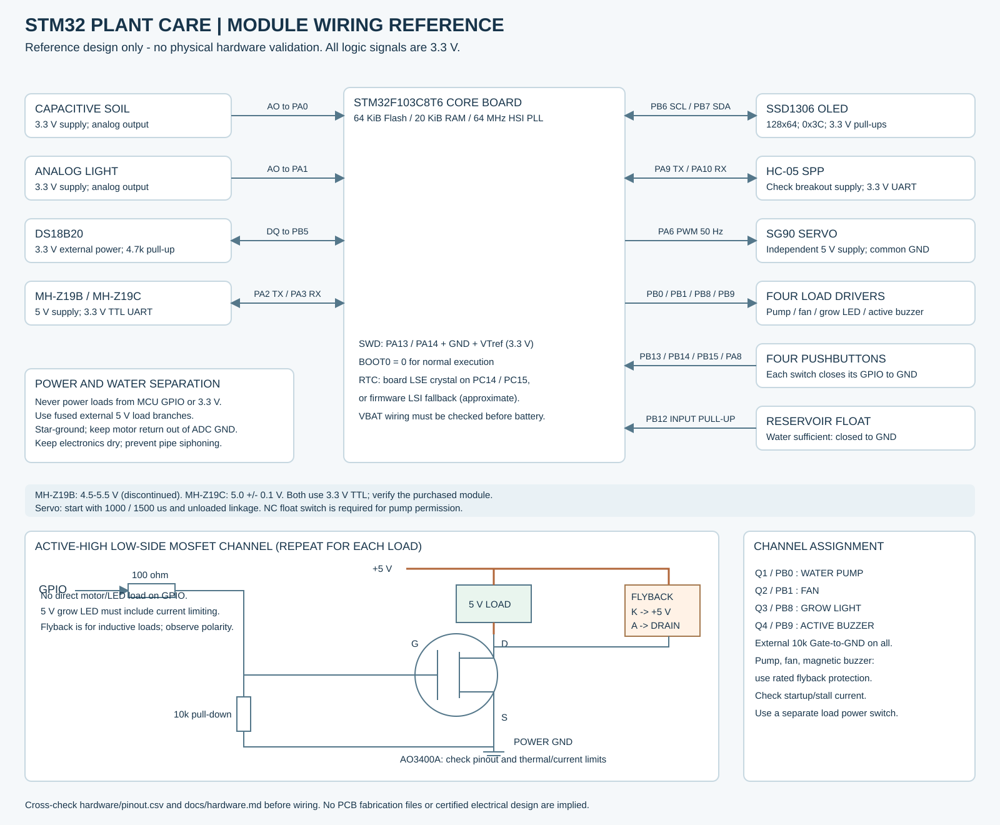

# 基于 STM32 的多参数智能绿植养护系统

STM32F103C8T6 教学原型参考工程：采集温度、土壤相对湿度、相对光照和 CO₂，通过自动、手动、蓝牙三种模式控制风扇、水泵、补光灯及舵机遮阳。

**当前交付状态：固件已在本机编译，控制核心及电脑端协议测试已运行** 
## 内容

| 目录 | 内容 |
|---|---|
| `firmware/` | C11 固件：外设驱动、状态机、限时浇水、传感器校验、双页配置、RTC |
| `keil/PlantCare.uvprojx` | Keil MDK / Arm Compiler 6 工程 |
| `desktop/` | Python Tk 控制台、实时显示、曲线、CSV 记录 |
| `tests/` | 真正运行 C 控制核心的测试与软件演示适配器 |
| `hardware/` | 采购清单、引脚表、参考接线图 |
| `docs/` | 搭建、标定、协议、验收、验证结果及修订项目说明 |
| `release/` | 从当前源码构建的 HEX/BIN、校验值及构建摘要；待实物验证 |
| `vendor/` | 固定版本 ST / Arm CMSIS 文件及原许可、来源与哈希 |

## 已实现的软件功能

- 两路 ADC 中值滤波和双点标定；DS18B20 完成转换后读温度并校验 CRC；MH-Z19 UART 校验、预热和超时处理。
- 自动阈值与回差；手动按键；蓝牙 ASCII 指令与 JSON 遥测；四键调阈值；SSD1306 英文数字界面。
- 水泵默认每次最多 3 秒、停止后冷却 60 秒、每个运行小时最多累计 15 秒；水位开关、土壤采样及标定共同许可。所有模式均受限制。
- 蓝牙控制 10 秒无有效心跳/控制指令即全部输出归零；本地手动 30 秒无操作归零；复位后进入手动并撤销执行请求。
- 显式保存配置，双 Flash 页与 CRC；RTC 优先 LSE、失败回退 LSI；独立看门狗。

这里的“输出归零”表示水泵、风扇、灯、蜂鸣器关闭，舵机回到参考打开位置（仍有 PWM）。停机或检修时还应切断负载电源。

## 先运行软件演示

安装 Python 3.10+（包含 Tk）和本机 C 编译器后，在项目根目录运行：

```powershell
# Windows 示例：使用官网 Zig 解压包中的 C 编译器；不要求安装到系统目录
python tools/test.py --cc '"C:\Tools\zig\zig.exe" cc'
python desktop/app.py --demo
```

Linux 的测试可用 `python3 tools/test.py --cc gcc`。界面还需系统的 Tk 包。演示依赖刚刚构建的 `build/tests/plant_sim`，默认使用标定完成、CO₂ 预热完成的虚拟环境。点击“自动养护”后切换“高温干燥”等场景，可查看相同 C 控制逻辑的输出。

软件演示无需 pyserial。连接实物前运行 `python -m pip install -r requirements.txt`，再运行 `python desktop/app.py`。具体步骤见[电脑与手机控制](docs/companion.md)。

## 构建和搭建

1. 阅读[硬件接线](docs/hardware.md)，按[采购清单](hardware/bom.csv)分阶段准备零件。
2. 打开 `keil/PlantCare.uvprojx`，选择 Arm Compiler 6；或运行 `python tools/build_keil.py --bin "C:\Keil_v5\ARM\ARMCLANG\bin"`。
3. 按[编译与烧录](docs/build-flash.md)通过 ST-Link/SWD 烧录；第一次只接主控、显示和传感器，负载电源保持断开。
4. 完成[两点标定](docs/calibration.md)，核对浮球输入和 MOSFET 输出极性，再分别测试执行机构。
5. 按[硬件验收表](docs/acceptance.md)逐项记录。软件检查的证据和边界见[验证报告](docs/validation.md)。



## 使用边界

光照和土壤湿度是标定后的相对量，不是 Lux 或体积含水率。蓝牙是近距离 SPP 串口，不是互联网远程；不包含独立手机 App、云平台、Wi-Fi、病害识别或已经制造的 PCB。CO₂ 蜂鸣提示用于课程演示，不能替代独立的环境安全报警装置。

未配置水位开关或未标定土壤时，水泵不能启动。硬件驱动限定为本项目描述的 **3.3V 高电平开启、低电平关闭** 方案。默认阈值只是台架起点，不是某种植物的养护配方。计时预算存于 RAM，断电会重置，不能防止反复断电造成的重复浇水；无流量检测，也不能识别全部传感器故障。

原始计划书含个人信息和未经实物验证的陈述，不包含在本仓库。[修订项目说明](docs/project-proposal.md)按实际进展重写。应用代码尚未选择统一开源许可证；`vendor/` 的 ST 和 Arm 文件保持其原 Apache-2.0 许可，详见 [THIRD_PARTY_NOTICES.md](THIRD_PARTY_NOTICES.md)。
