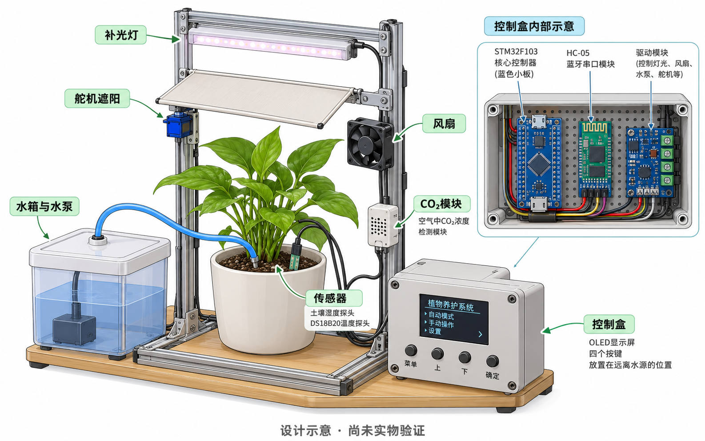
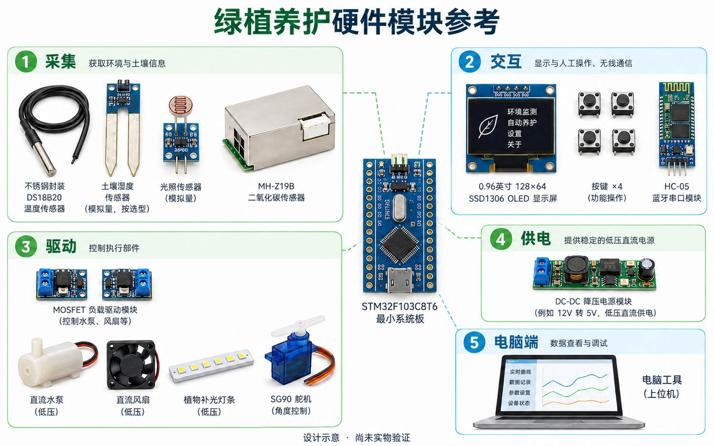
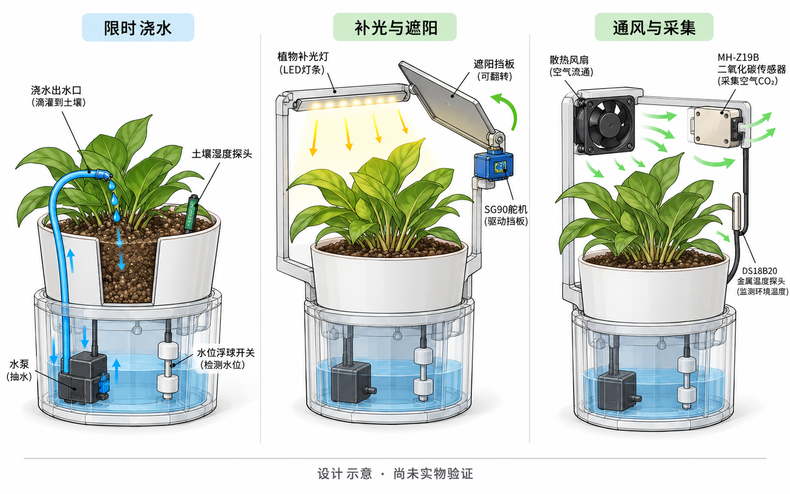
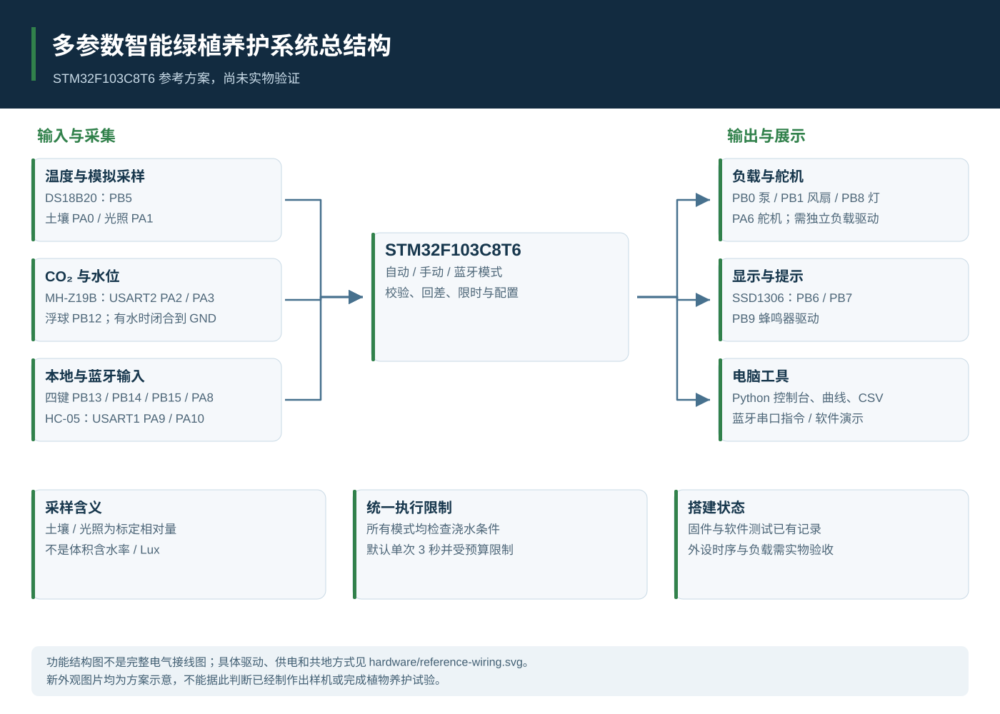
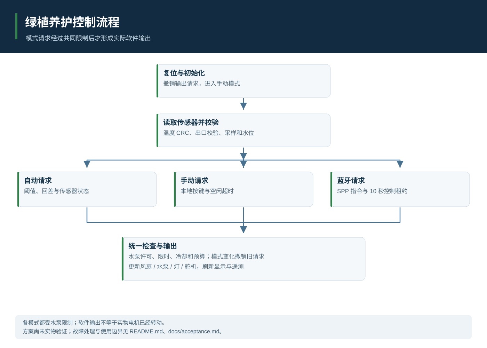
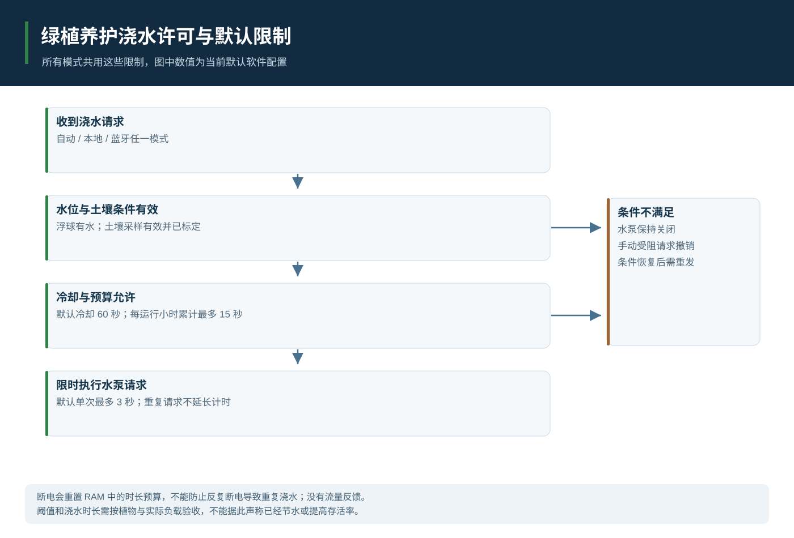
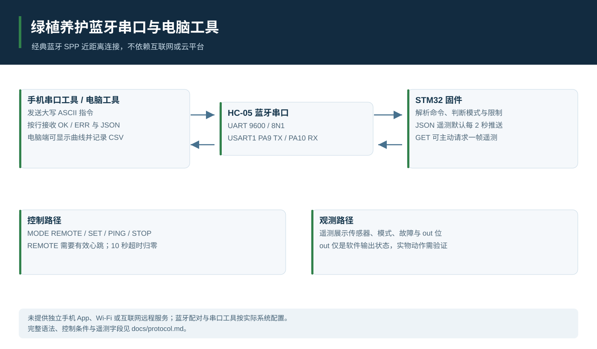

# 绿植养护方案图与控制结构

本项目尚无实物。以下三张外观与布局图由内置图片生成工具制作，均为设计示意；结构图依据当前公开软件和参考硬件绘制。它们不证明已经制作样机、完成养护或测得性能。

[返回项目首页](../README.md) · [查看制图提示词和图片记录](images/sources.json)

## 整体搭建效果示意

展示花盆、水箱、泵、风扇、灯、遮阳和干区控制盒的概念布局。外形和尺寸并非已制造方案，图中屏幕排版也不是实际固件截图。

## 硬件模块布局参考

用分组方式说明主控、采集、交互、驱动和低压供电。图中器件造型仅为示意，型号与数量以采购清单、接线和代码为准。

## 浇水补光与通风路径示意

解释水路、光路、舵机遮阳与通风采集。图中机械布局是解释性示意，不能作为已完成的结构设计或接线依据。

## 系统总结构

## 模式与控制流程

## 浇水许可与保护限制

## 蓝牙与电脑数据路径

## 参考接线与验证入口

搭建前阅读[硬件说明](hardware.md)、[标定说明](calibration.md)、[协议](protocol.md)及[验收表](acceptance.md)。STM32 不能直接驱动水泵、风扇或补光灯，负载驱动与供电以参考接线图为准。新示意图中的中文屏幕不是固件实际界面；当前固件 OLED 为英文数字显示。
